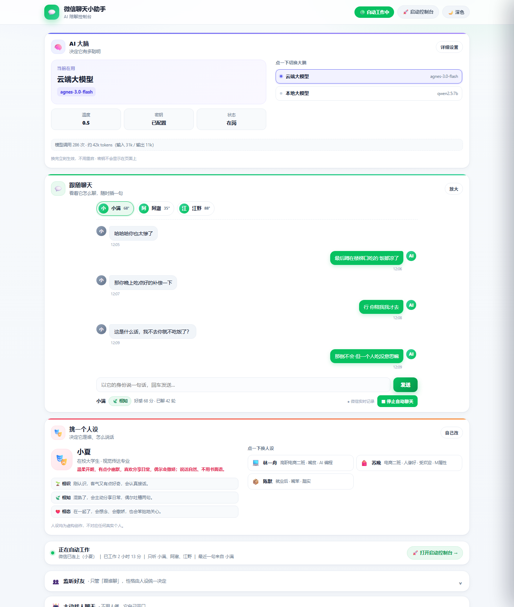
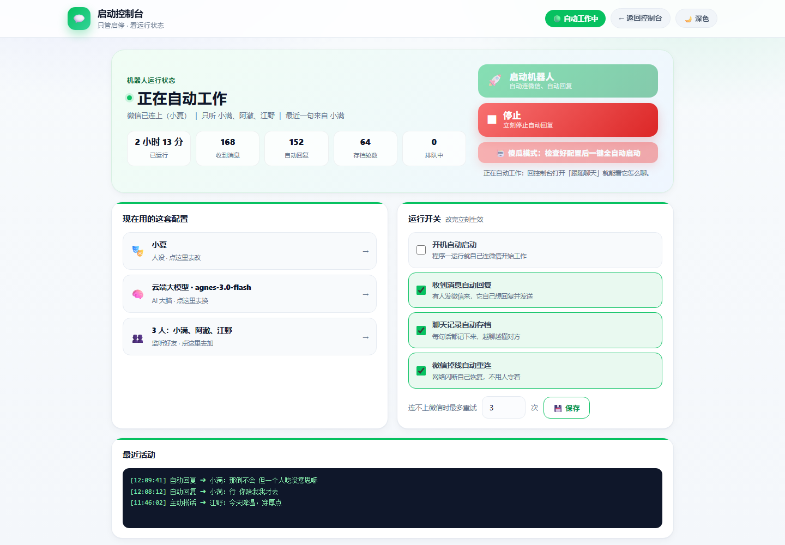

# 微信小号情感陪伴聊天机器人 (相识 ➔ 相知 ➔ 相恋)

这是一个专门为**微信个人小号 / 伴侣陪伴小号**定制的轻量级 AI 自动聊天程序，针对微信新版渲染进行了适配，并加入了**浏览器可视化人格调控中心**。

---

## 🖼️ 新版界面：三大核心面板



打开控制台，从上到下依次是三个最重要的部分（截图使用演示数据，手机端也是同样顺序）：

| 面板 | 你可以在这里做什么 |
| --- | --- |
| 🧠 **AI 大脑** | 查看当前模型、一键切换云端 / 本地模型、填 API Key、查看调用用量；点「详细设置」打开完整抽屉 |
| 💬 **跟随聊天** | 选中好友后实时显示它和对方的聊天流水（优先读微信真实记录），可手动插话、让 AI 代写，点「放大」全屏看 |
| 🎭 **挑一个人设** | 点预设卡快速换人设，或点「自己改」编辑姓名 / 身份 / 性格 / 三阶段提示词，保存立刻生效 |

第一次使用还会出现一条「👋 三步引导」提示条，配好人设和 AI 大脑后自动消失。

**启动 / 停止单独放在「启动控制台」页面**（`http://127.0.0.1:5000/run`），点配置页右上角的「🚀 启动控制台」进入：



启动、停止、运行统计、运行开关都在这个页面，配置页只负责人设 / AI 大脑 / 聊天。

---

## ⚡ 核心运行模式：一次配置，启动即运行（本版重点更新）

程序现在把「配置」和「运行」彻底分开了，机器人是**全自动运行**的，而不是每收到一条消息都要你点一下：

| 阶段 | 谁来做 | 做什么 |
| --- | --- | --- |
| **配置阶段** | 你（只做一次） | 设置人设 / 三阶段提示词、选择 LLM（云端大模型 或 本地大模型）、设置微信账号与监听范围、设定自动回复规则与记忆策略 |
| **运行阶段** | 机器人（全自动） | 在启动控制台点一次「🚀 启动机器人」之后：① 自动连接微信 ➔ ② 自动监听新消息 ➔ ③ 自动读取聊天上下文 ➔ ④ 自动调用已配置的模型 ➔ ⑤ 自动生成回复 ➔ ⑥ 自动发送 ➔ ⑦ 自动保存聊天记录与 Memory ➔ ⑧ 持续监听 |

**启动之后不需要再点击「回复」「生成」，也不需要输入任何指令。** 关闭程序即停止自动回复（点「⏹ 停止」也一样）。

独立的 **启动控制台**（`/run`）页面可以：

- **🚀 启动机器人 / ⏹ 停止机器人**：一键启停。启动过程全自动，连接失败会自动重试 —— 即使程序先启动、微信后登录，也会自动接上继续跑，无需再点一次。
- **开机自动启动**（默认开启）：以后只要运行一次程序，它自己就连微信、开监听、开自动回复，真正做到「一次配置，启动即运行」。
- **自动回复**：收到消息即自动生成并发送；临时不想回消息可取消勾选（仍会记录聊天记录与 Memory）。
- **自动保存聊天记忆**：每条来往消息自动落盘到 `chat_histories.json`，重启不丢上下文。
- **微信掉线自动重连**：微信崩溃/退出后，巡检线程会自动重连并恢复监听，无需人工干预。
- 实时状态：`⚪ 未启动 / 🟡 正在连接微信... / 🟢 全自动运行中 / 🔴 启动失败`，并显示已运行时长、已监听会话数、
  自动接收消息数、自动回复次数、自动存记忆轮数、待回复队列、记忆总量、最近来信与最近自动回复。

> 运行设置保存在 `persona.json` 的 `runtime` 段（不用每次重设），配置一次即可长期自动运行。

---

## 🌟 核心特性

1. **从相识到相恋 · 动态情感轨迹**：
   - **🌱 第一阶段：相识（0~29分）**：初识礼貌客气、带有恰当的分寸感与轻微防备心。
   - **🍃 第二阶段：相知（30~79分）**：熟络挚友、分享欲拉满、会开玩笑吐槽互损、情绪共鸣。
   - **❤️ 第三阶段：相恋（80分以上）**：心动伴侣、亲昵依赖、温柔宠溺、会撒娇吃醋、主动报备。
   - **双轨推进机制**：随着日常微信真实聊天自动增加好感度；同时支持在浏览器后台实时滑块调整或强制指定阶段。
2. **🌐 浏览器可视化人格控制台 (Web UI)**：
   - 程序启动后**自动在浏览器弹出控制后台**（`http://127.0.0.1:5000`）。
   - 可在网页上随时编辑伴侣姓名、年龄、身份、核心性格以及**三阶段专属提示词 (Prompt)**。
   - **热更新即时生效**：网页点击保存后正在运行的聊天程序瞬间应用最新人设，无需重启！
3. **🤖 全自动主动搭话 · 机器人自己定时找人聊天（新增）**：
   - 网页里的「🤖 主动找人聊天」折叠面板打开开关后即可**无人值守**运行，不需要任何手动点击。
   - 可自由配置：**每隔 N 分钟**搭话一次、**活跃时段**（如 9:00-23:00，支持跨午夜如 22:00-6:00）、**每天最多条数**、**间隔随机浮动**（消除整点机械感）。
   - **自动轮流选人**：每轮优先挑"最久没被搭话"的好友，让名单里的人都被照顾到；也可在好友卡片上点 `🤖 加入自动` 精确控制对象（留空则默认使用监听白名单好友）。
   - **话题池**：每行写一个话题方向（如"问候对方今天在做什么"），机器人每次随机取一个，结合人设 + 当前关系阶段生成自然开场白；留空则由 AI 自由发挥。
   - 自动搭话默认带**拟人打字延迟**，并按设置**累积好感度**，让关系在不知不觉中往前推进；面板实时显示今日条数、上次对象、下次预计时间。

4. **🎯 好友选择 · 跟随聊天 · 选中谁就以谁的名义发消息（手动模式）**：
   - 「💬 跟随聊天」面板会列出**监听白名单好友 + 已互动好友**，点击卡片即可选中目标，并实时显示你们聊到哪了。
   - 选中后可以：
     - **🚀 直接发消息**：手动输入内容，用反斜杠 `\` 分隔还能像真人一样分多条发出。
     - **✍️ AI 生成搭话**：让 AI 按当前人设 + 当前关系阶段生成一句主动问候/分享，填进输入框供你修改。
     - **💌 AI 生成并发送**：一键让 TA 主动找对方聊天（可指定话题，如“问问对方周末安排”）。
   - 每次发送都会写进对话记忆，后续聊天上下文连贯；面板底部实时显示**操作日志**与成功/失败状态。
5. **高拟人度回复体验**：
   - **仿真打字延迟**：按字数动态计算打字耗时（0.12s/字 + 随机延迟），杜绝非人秒回。
   - **分段打字发送**：像真人发微信一样，把一句长回复拆成 2~3 段陆续发送。
   - **消息合并缓冲**：对方连续发多条消息时，机器人自动等待几秒合并上下文统一作答。
6. **免费多模态视觉感知**：
   - 接入 Moonshot 免费额度识别好友发来的**图片**和**表情包**，看懂图片并在对话中贴切回应。
   - 包含多情绪表情包图库（`emojis/`），回复时会根据气氛概率随机发送配套表情包。

---

## 📁 目录文件说明

```text
wechat-bot/
├── 一键启动.bat         # ★ 唯一启动入口：环境自检 + 自动装依赖 + 启动全自动运行
├── boot.py             # 跨平台启动入口（python boot.py）
├── requirements.txt     # 依赖清单 (一键启动.bat 首次运行时自动 pip 安装)
├── README.md           # 项目总览与快速开始
├── selftest.py         # 自检脚本 (python selftest.py，结果写入 selftest_report.txt)
├── persona.json        # 人设 / 三阶段提示词 / 好感度 / 自动搭话配置 / 运行模式配置(runtime)
├── models_config.json  # 模型 Provider 配置 (默认两个：云端大模型 / 本地大模型，可热切换)
├── config.py           # 核心配置文件 (监听好友、端口等；**不含密钥**，可安全提交)
├── config_local.py     # 本地私有配置 (**已被 .gitignore 忽略**，密钥写在这里)
├── config_local.py.example # 本地私有配置模板，复制成 config_local.py 后填密钥
├── models_config.example.json # 模型配置模板（网页会自动生成真的那份）
├── main.py             # 核心主程序 (机器人运行时、消息监听、AI请求、Flask控制台)
├── wxbot.py            # 微信底层驱动兼容层 (适配最新版微信渲染、读取通讯录)
├── wxfeatures.py       # 微信侧高级功能
├── presets.py          # 三套开箱即用的人设预设
├── llm/                # 统一大模型接口层 (与厂商解耦，上层只调 llm.chat_completion)
│   ├── base.py         # 抽象基类 / 配置与响应数据结构
│   ├── config_manager.py # Provider 配置持久化与热切换
│   ├── factory.py      # Provider 工厂
│   └── providers/      # openai / ollama / llamacpp 具体实现
├── mind/               # 「大脑」层：人格 / 情绪 / 记忆 / 节奏 / 提示词
├── templates/          # 网页模板
│   ├── index.html      # 配置控制台（AI 大脑 / 跟随聊天 / 挑一个人设）
│   └── run.html        # 启动 / 停止控制台
├── static/             # 控制台 CSS / JS / 图标
│   └── js/run.js       # 启动控制台脚本
├── prompts/            # 人设提示词备份目录
└── emojis/             # 情绪表情包图库
```

---

## 🚀 快速使用指南

> **只有一个启动入口 —— 双击 `一键启动.bat`**（macOS / Linux 用 `python boot.py`），
> 环境与依赖全自动搞定，随后自动连接微信进入全自动运行（默认已开启「开机自动启动」）。

### 第一步：准备 Python（仅第一次需要）
安装 **Python 3.9 以上**：https://www.python.org/downloads/
安装时务必勾选 **Add python.exe to PATH**。除此之外**不需要手动敲任何 pip 命令**。

### 第二步：配置 API Key（三种方式任选其一）

**方式 A：网页里填（推荐）**
启动后在网页「🧠 AI 大脑」面板填 Key，保存即生效。

**方式 B：本地私有文件**
```bash
copy config_local.py.example config_local.py    # Windows
# cp config_local.py.example config_local.py    # macOS / Linux
```
然后编辑 `config_local.py`，填入 `API_KEY` / `BASE_URL` / `MODEL`。
`config_local.py` 已被 `.gitignore` 忽略，**永远不会被提交**。

**方式 C：环境变量**
```bash
export WECHATBOT_API_KEY="sk-你的密钥"
export WECHATBOT_BASE_URL="https://api.deepseek.com/v1"
export WECHATBOT_MODEL="deepseek-chat"
```

**取值优先级：环境变量 > `config_local.py` > `models_config.json`（网页里存的）> 空**

> 这条优先级作用于**默认大脑**（`default_cloud`，程序第一次启动时用 `config.py` 播种的那一个）的
> `API_KEY` / `BASE_URL` / `MODEL`，**运行时持续生效**——改完环境变量重启就换密钥。
> 网页里**自己新建**的其他 Provider 不受影响，只认 `models_config.json` 里存的值。
>
> 网页「🧠 AI 大脑」面板会显示密钥来源（`env` / `config_local` / `saved`），
> 且**永不回显密钥明文**。密钥来自环境变量或 `config_local.py` 时，
> 输入框里填的值不会生效（优先级更高），面板会提示。

### 第三步：设置监听目标

监听好友可以直接在网页上点好友卡片添加，更方便。
若想改代码默认值，编辑 `config.py` 里的 `LISTEN_LIST`：

```python
LISTEN_LIST = [
    ["我的大号"],   # 昵称必须和微信通讯录里的昵称/备注一字不差
]
```

### 第四步：登录电脑微信
在电脑上登录你的微信小号，让微信窗口在后台保持运行。

### 第四步：一键启动（双击即可）
双击 **`一键启动.bat`**（项目唯一启动入口）：

1. **环境自检**：自动查找 Python；找不到时给出中文安装提示并安全退出（不会闪退）。
2. **依赖自动安装**：自动检查 `flask / requests / wechatauto`，缺少时执行
   `pip install -r requirements.txt`，默认源失败会自动改用**国内镜像**重试；依赖已就绪则秒过（首次约 1~3 分钟）。
3. **启动即运行**：启动后自动连接微信并进入**全自动运行**模式，浏览器自动弹出 **`http://127.0.0.1:5000`** 控制台大屏。

> 排查环境用：`一键启动.bat --check` —— 只做 Python 与依赖检查后退出，不启动机器人、不打开浏览器。

随后在网页上：

1. **配置页（`/`）**：一屏是 **🧠 AI 大脑 / 💬 跟随聊天 / 🎭 挑一个人设** 三个面板，
   第一次使用顶部还会有「👋 三步引导」，按顺序挑人设、配大脑即可。
2. **启动控制台（`/run`）**：点页面右上角「🚀 启动控制台」进入，这里才是启动 / 停止的地方：
   - **🚀 启动机器人 / ⏹ 停止**：一键启停。启动过程全自动，连接失败会自动重试 —— 即使程序先启动、微信后登录，也会自动接上继续跑。
   - **🤖 傻瓜模式**：检查人设和 AI 大脑都配好后，一键保存运行设置并启动。
   - 看运行时长、收发消息数、存档轮数、排队数；运行开关（开机自动启动 / 自动回复 / 自动存记忆 / 掉线重连）也在这里改。
3. **其余常用操作**（都在配置页）：
   - **跟随聊天**：点好友卡片选中目标，可手动发消息，或输入话题后点「💌 写完直接发」，让 TA 主动去找对方搭话。
   - 随时拖动好感度滑块，或强制切换好友的阶段（相识 / 相知 / 相恋）。
   - 修改机器人的性格、说话习惯以及各个阶段的 Prompt 提示词。
   - 点击“保存”，机器人立刻以新人设进行微信回复！

> **配置完直接走人**：人设 / 模型 / 微信账号 / 上下文 / 自动回复规则都设置好之后，
> 只要保持程序运行，机器人就会自己监听新消息、自动读上下文、自动调模型、自动回复、自动存记忆，
> 全程无需你再点任何按钮；关闭程序（或在启动控制台点「停止」）才会停止自动回复。

### 第五步：开启「全自动主动搭话」（不想手动就打开这个）
在配置页下方的 **🤖 主动找人聊天** 折叠区里：
1. **勾选「启用全自动搭话」** —— 勾上即刻生效并自动排期，不用再点别的（随时取消勾选即停止）。
2. **填节奏**：`每隔多少分钟主动搭话一次`（如 60）、`活跃时段`（如 9 ➔ 23；填 22 ➔ 6 表示夜里到清晨也聊）、`每天最多搭话`（防止刷屏，如 20 条）。
3. **选对象**：在话题池下方的名单里点选好友；或直接在好友卡片上点 `🤖 加入自动 / 🤖 自动中` 切换。留空则默认对**监听白名单**里的好友轮流搭话。
4. **写话题池**（可选）：每行一个话题方向，机器人每次随机取一个当开场灵感，例如：
   ```text
   分享今天遇到的一件小事
   问候对方今天吃了什么
   约对方周末一起去做件事
   ```
5. 想看效果就点 **▶️ 立即自动搭话一次**（不受时间/次数限制，立刻生成并发送一条）。
6. 面板状态条会显示：`今日已发 X / 上限 条`、`上次搭话时间与对象`、`下次预计时间`、以及当前为什么没发（未启用 / 微信未连接 / 不在活跃时段 / 已达上限 / 未到时间）。

> 提示：好感度、关系阶段、人设提示词会一并作用于自动搭话的话术，所以先把人设和好感度调好，自动聊出来的味道会更像 TA。

---

## 🔐 安全与隐私须知

**这个程序会读取你本机微信的聊天记录，并把内容发给大模型。请务必了解以下几点：**

1. **密钥绝不写进会被提交的文件。**
   - `config_local.py`（本地密钥）→ 已被 `.gitignore` 忽略
   - `models_config.json`（网页里存的配置）→ 已被 `.gitignore` 忽略
   - 仓库里提供的是 `config_local.py.example` / `models_config.example.json` 模板。

2. **密钥泄露过就要立刻轮换。**
   如果 Key 曾经进过 Git，删掉文件是**没用的**——去服务商后台吊销并重新生成才是唯一正确做法。
   Git 历史里的内容会永久留存，即使 `git rm` 也删不掉。

3. **Web 控制台没有登录认证，只监听 `127.0.0.1`。**
   不要把 `WEB_UI_PORT` 改成 `0.0.0.0` 暴露到公网或局域网。
   里面能控制微信发消息、改人设、读聊天记录——暴露出去等于把你的微信交出去。

4. **接口不返回密钥明文。**
   `/api/llm/providers`、`/api/llm/save_provider`、`/api/llm/switch`、`/api/bot/status`
   都只返回 `has_api_key` 标记，密钥留在服务端；保存时密钥留空 = 沿用原来的。

5. **聊天记录是隐私，仓库里不放。**
   `chat_histories.json`、`mind_state.json`、`mind_bank.json`、`persona.json`、
   `persona_archives/`、`wechatauto_logs/` 全部已 gitignore。

6. **默认只监听白名单、忽略群聊。**
   建议保持 `IGNORE_GROUP_CHAT = True`，避免在群里刷屏导致账号被限制。

7. **⚖️ 请合规使用。**
   仅供个人学习与娱乐；不得用于骚扰、诈骗、批量营销或冒充他人。
   违反微信用户协议造成的封号或损失由使用者自行承担。
   详见下方 [📜 免责声明与合规须知](#-免责声明与合规须知)。

---

## 📜 免责声明与合规须知

请在使用前完整阅读以下条款。**使用本项目即表示你已阅读并同意承担由此产生的一切责任。**

### 一、项目性质

- 本项目仅供**个人学习、技术研究与娱乐**用途，不提供任何商业化服务或商业支持。
- 本项目是一个**技术演示**，不保证可用性、稳定性、安全性或任何形式的服务质量。

### 二、人设与内容声明

- **内置的三套人设（林一舟 / 苏晚 / 陈默）纯属虚构创作。**
  其姓名、年龄、性别、身份、性格、经历、校园与班级背景等全部为虚构设定，
  **不对应、不影射任何真实个人、真实班级或真实学校**，也未经过任何真实人物授权。
- 套用这些预设后，机器人在被问到「你是不是真人」「你是不是机器人」时，
  会如实说明自己是 AI 与虚构人设设定，**不会伪装真人身份**。
- 用户自行在网页里编写的自定义人设内容由用户自行负责，需自行确保不冒充他人、不侵权。

### 三、合法合规使用

- 请严格遵守**微信用户协议**、**微信平台运营规范**以及相关法律法规。
- **严禁**将本项目用于骚扰、诈骗、批量营销、骚扰广告、冒充他人、侵犯隐私、
  伪造身份或其他任何违法违规用途。
- 使用本项目导致的账号限制、功能封禁、封号、投诉、法律责任或任何其他损失，
  **由使用者自行承担**，与项目作者无关。
- 涉及第三方 AI 服务商的调用时，使用者需自行遵守该服务商的**用户协议、
  隐私政策与数据合规要求**（尤其是聊天记录会上传至云端模型这一点）。
- 请勿将本项目用于任何商业场景，亦不得以此牟利。

### 四、数据与隐私

- 本程序会读取本机微信聊天记录，并将内容发送至用户自行配置的 AI 服务商。
  **用户需自行评估并承担由此产生的数据合规风险。**
- 仓库不包含任何 API Key；请勿将个人密钥提交到 Git 或公开渠道。
- 请自行做好备份与数据清理，卸载前建议删除本目录下的聊天记录与日志文件。

### 五、责任限制

- 本项目以「现状」提供，**作者不对任何直接或间接损失承担责任**，
  包括但不限于账号封禁、数据丢失、费用损失、隐私泄露或第三方索赔。
- 若你不能接受上述条款，请不要使用本项目。

---
---

## 🧠 它现在真的会「看微信聊天记录」（本版重点更新）

程序会直接读取**本机微信的本地消息库**，聊天前先看一眼你们真实聊过什么：

1. **主动搭话前先看记录**：每轮自动搭话都会先取出与这个好友最近的聊天记录（默认 20 条），
   算出「上次聊到几点、最后一条是谁发的、隔了多久」，再决定是**接对方的话**还是**另起新话题**。
2. **不会突然失忆**：程序刚启动、内存里还没有对话记忆时收到消息，
   会自动从微信记录里补齐上下文（日志打印 `从微信记录恢复了 N 条上下文`）。
3. **被晾着的人优先接话**：如果对方最后一条你还没回，机器人默认接这句话，
   而不是自顾自换个话题；如果最后一条是你自己发的、对方没回，则强制换个新说法。
4. **网页可核对**：好友面板点 **🔍 查看 TA 读到的上下文**，能直接看到机器人眼里的聊天记录
   （谁说的、几点说的）、最后一条谁发的、对方有没有被你晾着、距今多少分钟。
5. **15 秒缓存**：上下文读一次缓存 15 秒，网页 8 秒一次的轮询不会把微信数据库读爆；
   收到新消息时会立刻清掉该好友缓存，保证读到最新内容。

> 说明：读库依赖 `wechatauto`（本项目的底层驱动）。微信未登录、数据库被占用或版本不支持时
> 会自动降级为「无上下文」模式，程序照常运行，只是聊天前看不到历史记录。

## 🗣️ 让它「像微信好友」的三道加工

| 环节 | 干什么 |
| --- | --- |
| `sanitize_outreach_text` | 丢掉「（微笑）」这类括号旁白、整行引号、Markdown 标题/加粗/分点 |
| `humanize_outreach_text` | 书面腔 ➔ 微信口语（您➔你、因此➔所以、"有什么可以帮您的吗"➔"有啥需要随时说"）；去掉句末句号；**主动搭话最多发 2 条、被动回复最多 4 条**；**砍掉第二个问句**（真人不会连着查户口） |
| `is_repeat_message` | 与最近 12 条发过的内容做相似度比对，太像就自动重写一版，杜绝复读机 |

再配上**同一好友最短间隔冷却**（默认 2 小时，网页可调）：处在冷却里的好友会被**自动跳过、换下一个**，
而不是整轮空转；全部好友都在冷却时，网页状态条会显示「好友都在冷却中，最快约 N 分钟后自动继续」。

## 🧪 自测命令

```bat
python selftest.py        :: 纯逻辑自检（配置 / 好感 / 提示词 / 记忆 / 模型 / 监听名单等，结果写入 selftest_report.txt）
python -c "import main"   :: 只检查主程序能否正常导入（不启动机器人）
```

